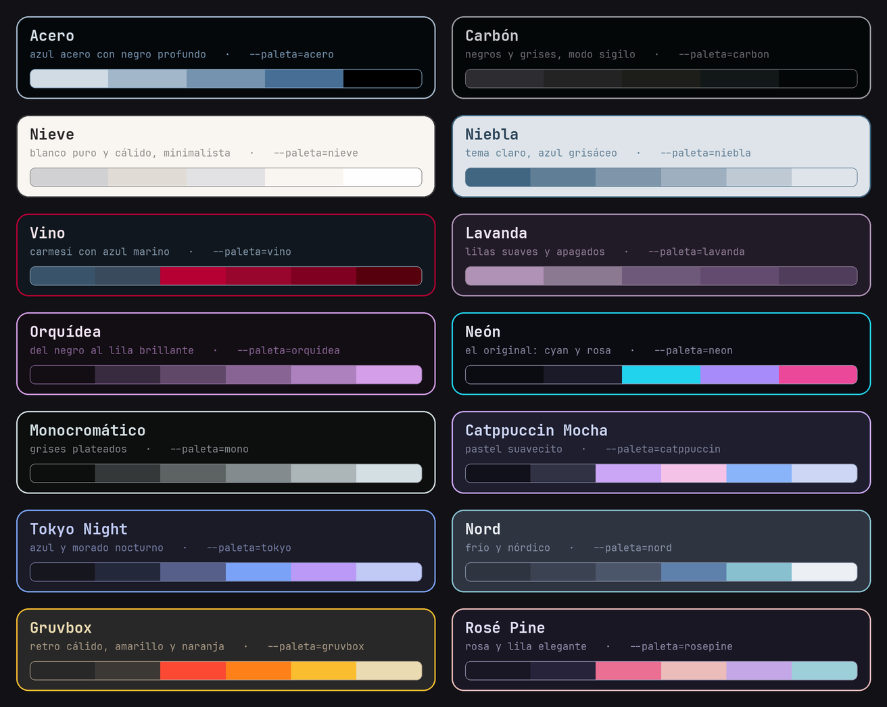

# ZERO — rice para Hyprland

[](https://github.com/Zer0-HMA/zero-rice/actions/workflows/revisar.yml)


[](LICENSE)

*[English version](README.en.md)*

Configuración completa para **Arch Linux + Hyprland** (config en Lua): barra con AGS, lanzador con clima y estadísticas, 14 paletas de colores que cambian todo el escritorio con un atajo, menú de red, capturas de pantalla con vista previa y más.


## Qué trae

- **Look de Hyprland:** bordes con degradado animado, esquinas redondeadas, blur, sombras y animaciones suaves.
- **Barra (AGS v3):** tu **foto de perfil** y nombre (se pone **blanca cuando eres root**), workspaces 1–5, reloj con calendario, música, red, CPU/RAM/temperatura, volumen, batería, bandeja, paletas, **contador de notificaciones** con No molestar y menú de energía. Tiene un guardián que la levanta sola si se cae.
- **OSD de volumen y brillo:** aparece en el monitor donde estás, con cualquier forma de cambiarlos (teclas, rueda, pavucontrol).
- **Workspaces en 3D:** 12 efectos (cubo, carrusel, puerta, túnel, persianas, mosaico…) al cambiar de workspace con `Super + número` o la rueda.
- **14 estilos de animaciones:** Elástico, Zoom, Cine, Retro, Fluido… con velocidad ajustable, desde un menú.
- **Lanzador (Rofi):** panel con saludo según la hora, reloj, **clima de tu ciudad** y estadísticas de tu PC; apps en cuadrícula y pestañas Apps / Comandos / Archivos.
- **14 paletas de colores:** cambian bordes, barra, lanzador, menús, notificaciones, terminal y fondo de pantalla al mismo tiempo. Puedes agregar las tuyas.
- **Clima:** detecta tu ciudad por internet, o la eliges de una lista que se filtra mientras escribes.
- **Menú de red:** Wi-Fi con barras de señal, redes ocultas, cable y configuración avanzada.
- **Capturas de pantalla:** área, pantalla o ventana; notificación con vista previa y botones Abrir / Carpeta / Editar / Borrar.
- **Notificaciones (SwayNC)** y **fondos de pantalla (awww)** con selector de miniaturas.
- **Pantalla de bloqueo (hyprlock)** con los colores de tu paleta, y bloqueo automático a los 10 minutos (hypridle).
- **Historial del portapapeles** (cliphist) con texto e imágenes.
- **Apps GTK con tu paleta:** Thunar y las demás apps GTK cambian de color y de modo claro/oscuro junto con todo lo demás.
- **Tailscale** en el menú de red y en la barra, si lo tienes instalado.
- Lo que un escritorio necesita para el día a día: agente de **polkit** (ventanas de contraseña) y **portal de escritorio** (compartir pantalla en Discord, Meet, OBS).

## Requisitos

- Arch Linux (o derivada con `pacman`).
- **Hyprland con config en Lua** (`hyprland.lua`, versión 0.55 o más nueva). Si todavía tienes `hyprland.conf`, actualiza primero con `sudo pacman -Syu hyprland`.
- Internet durante la instalación.

Todo lo demás lo instala el script: kitty, rofi, swaync, NetworkManager, pipewire, fuentes, íconos, AGS y sus librerías desde el AUR (instala `yay` si no lo tienes), etc.

## Instalación

```bash
git clone https://github.com/Zer0-HMA/zero-rice.git
cd zero-rice
./install.sh
```

El script pregunta antes de cada paso, respalda todo lo que reemplaza en `~/.config/rice-respaldo-<fecha>/` y al final te deja elegir la paleta inicial.

| Opción | Qué hace |
|---|---|
| `./install.sh --si` | Instala todo sin preguntar |
| `./install.sh --solo-configs` | No instala paquetes, solo las configuraciones |
| `./install.sh --paleta=tokyo` | Elige la paleta inicial |
| `./install.sh --actualizar` | Baja lo último del repo y actualiza (conserva tu paleta, tu fondo y tu ciudad) |
| `./install.sh --desinstalar` | Quita el rice (no borra paquetes; todo queda respaldado) |
| `./install.sh --version` | Muestra la versión instalada |
| `./install.sh --enlazar` | Enlaza `~/.config` al repo en vez de copiar (para desarrollar el rice) |

> Puedes correrlo desde la TTY antes de entrar a Hyprland por primera vez, o desde dentro de Hyprland (se aplica en vivo).

## Atajos

| Atajo | Acción |
|---|---|
| `Super + R` | Lanzador de apps |
| `Super + Shift + P` | Cambiar paleta de colores |
| `Super + Shift + A` | Elegir estilo de animaciones |
| `Super + Shift + E` | Elegir efecto 3D de los workspaces |
| `Super + Shift + F` | Foto de perfil y nombre (o clic en tu nombre en la barra) |
| `Super + 1…0` / `Super + rueda` | Cambiar de workspace (con el efecto 3D que elegiste) |
| `Super + Shift + C` | Elegir ciudad del clima |
| `Super + W` | Elegir fondo de pantalla (con miniaturas) |
| `Super + Shift + W` | Fondo aleatorio |
| `Super + N` | Centro de notificaciones |
| `Super + L` | Bloquear la pantalla |
| `Super + Shift + V` | Historial del portapapeles |
| `Super + Shift + N` | Menú de red |
| `Super + B` | Reiniciar la barra |
| `Impr Pant` / `Super + Shift + S` | Captura de un área |
| `Shift + Impr Pant` | Captura de pantalla completa |
| `Super + Impr Pant` | Captura de la ventana activa |
| `Super + Shift + Impr Pant` | Captura de pantalla en 5 segundos |

## Paletas



Se cambian con `Super + Shift + P`, con el botón de paleta de la barra o desde la terminal:

```bash
~/.config/hypr/scripts/paleta.sh tokyo       # una en específico
~/.config/hypr/scripts/paleta.sh aleatoria   # sorpresa
~/.config/hypr/scripts/paleta.sh tui         # elegir en la terminal
```

**Agregar tu propia paleta:** abre `~/.config/rice-paletas/paletas.txt`, copia una línea y cambia los colores. El formato viene explicado al principio del archivo. Si el color de fondo es claro, todo el escritorio se vuelve tema claro automáticamente.

Al principio de `~/.config/hypr/scripts/paleta.sh` puedes elegir qué cambia con la paleta:

| Opción | Qué hace |
|---|---|
| `CAMBIAR_FONDO=1` | (por defecto) pone el fondo de la paleta solo si tu fondo actual también es de paleta; si elegiste uno con `Super + W`, se respeta |
| `CAMBIAR_FONDO=2` | siempre pone el fondo de la paleta · `0` nunca toca tu fondo |
| `TEMA_KITTY=0` | no cambia los colores de kitty |
| `TEMA_GTK=0` | no cambia los colores de las apps GTK |
| `TEMA_BLOQUEO=0` | no cambia la pantalla de bloqueo |

Si ya tenías tu propio `hyprlock.conf` o `hypridle.conf`, el rice no los toca.

## Clima


- Al instalar, detecta tu ciudad por tu conexión a internet. Es aproximada, por eso dice "(aprox.)".
- Con `Super + Shift + C` eliges tu ciudad de una lista que **se filtra mientras escribes** (sin importar acentos). Las de tu país salen primero, con estado, país y población para no confundirte.
- Si tu pueblo no viene en la lista, escribe el nombre completo y presiona Enter para buscarlo en internet.
- La ciudad que elijas se queda guardada. Para volver a la detección automática: `~/.config/hypr/scripts/clima.sh auto`.
- Ver el clima en la terminal: `~/.config/hypr/scripts/clima.sh ver`.

## Personalizar

- **Tus propios ajustes de Hyprland** (monitores, teclado, más atajos…) van en `~/.config/hypr/mio.lua`. Se carga al final del rice, así que le gana a todo, y **el instalador nunca lo toca**, ni al actualizar. Ejemplo:

  ```lua
  hl.config({ input = { kb_layout = "latam" } })
  hl.bind("SUPER + T", hl.dsp.exec_cmd("thunar"))
  ```

- **Tus fondos de pantalla** van en `~/.config/wallpapers/` (jpg, png, webp, gif). Elígelos con `Super + W`.
- **Carpeta de capturas:** `~/Pictures/Capturas` (o la carpeta de imágenes de tu idioma). Se copian solas al portapapeles.

## Perfil, animaciones y workspaces 3D

**Foto de perfil:** con `Super + Shift + F` eliges una foto de tu colección o agregas una de tus Imágenes o Descargas; se recorta en círculo sola y aparece en la barra, el lanzador y la pantalla de bloqueo (`~/.face`). Desde la terminal: `perfil.sh ~/foto.jpg`, `perfil.sh nombre "Humber"`, `perfil.sh quitar`.

**Animaciones:** `Super + Shift + A` abre el menú con los 14 estilos, la velocidad y el borde girando. Desde la terminal: `animaciones.sh elastico`, `animaciones.sh velocidad rapida`, `animaciones.sh probar`.

**Workspaces 3D:** `Super + Shift + E` para elegir el efecto (o `Aleatorio`, o `Sin efecto 3D` para las animaciones normales de Hyprland). Funciona tomando una captura de la pantalla y animándola en una capa de la barra, así que no necesita plugins. Desde la terminal: `ws3d.sh efecto cubo`, `ws3d.sh velocidad rapida`, `ws3d.sh probar`.

## Para desarrollar el rice (modo enlazado)

```bash
./install.sh --enlazar
```

En vez de copiar los archivos a `~/.config`, los **enlaza al repo**: lo que edites en `~/.config/hypr/rice.lua` o en la barra queda directo en git, listo para `git commit`. Lo que generan las paletas y las animaciones (`colores.css`, `colores.lua`, `animaciones.lua`…) se queda en `~/.config` y nunca ensucia el repo. Se recuerda entre actualizaciones; para volver a copias normales: `./install.sh --copiar`.

## Dónde se guarda cada cosa

| Qué | Dónde |
|---|---|
| Configuración (lo que puedes editar) | `~/.config/hypr`, `~/.config/ags`, `~/.config/rofi`, `~/.config/rice-paletas` |
| Tus ajustes personales | `~/.config/hypr/mio.lua` (el instalador nunca lo toca) |
| Estado: paleta actual y tu ciudad | `~/.local/state/zero-rice` |
| Tus fotos de perfil | `~/.config/rice-perfil` (no se borran al desinstalar) |
| Efecto 3D y animaciones elegidas | `~/.config/rice-ws3d` y `~/.config/rice-animaciones` |
| Caché: clima, lista de ciudades, panel del lanzador | `~/.cache/zero-rice` (se puede borrar sin problema) |
| Logs | `$XDG_RUNTIME_DIR/zero-rice` (se borran al apagar) |

## Privacidad

Para el clima, el rice consulta tu ubicación aproximada por IP a [ip-api.com](https://ip-api.com) (por HTTP, sin cifrar) o, si falla, a [ipinfo.io](https://ipinfo.io). Si prefieres que no se consulte nada, elige tu ciudad con `Super + Shift + C`: así ya no se vuelve a detectar. El clima en sí viene de [Open-Meteo](https://open-meteo.com), que solo recibe las coordenadas de la ciudad.

## Problemas comunes

**La barra no aparece.** Corre `~/.config/hypr/scripts/barra.sh log` para ver el error. Si dice que falta algo de `Astal`, instala `yay -S libastal-meta`.

**La barra se cae al iniciar sesión, o salen dos.** Revisa que tu `hyprland.lua` no arranque `ags`, `swaync` o el daemon de fondos por su cuenta: el rice ya los arranca. El instalador lo detecta y te ofrece desactivarlos.

**El cursor parpadea o se ve feo en el segundo monitor (NVIDIA).** Pon esto en tu `mio.lua`:

```lua
hl.env("XCURSOR_THEME", "Bibata-Modern-Classic")
hl.env("HYPRCURSOR_THEME", "Bibata-Modern-Classic")
hl.config({ cursor = { no_hardware_cursors = 1 } })
```

y instala el tema con `yay -S bibata-cursor-theme-bin`.

**Sale una barra roja arriba de la pantalla.** Es un error en la config de Hyprland. Si acabas de editar `mio.lua`, revisa ese archivo.

**El clima dice "no disponible".** Revisa tu internet y elige tu ciudad con `Super + Shift + C`.

**Tailscale dice que necesita permiso.** Para conectarlo y desconectarlo desde el menú sin `sudo`, corre una vez `sudo tailscale set --operator=$USER`.

**Una app no me pide la contraseña de administrador.** Revisa que el agente de polkit esté corriendo: `systemctl --user status hyprpolkitagent`.

**El fondo de pantalla no cambia.** El proyecto `swww` se renombró a `awww`; el instalador instala `awww` desde el AUR, y los scripts usan el que tengas.

## Estructura del repo

```
zero-rice/
├── install.sh                      instalador (instalar / actualizar / desinstalar)
├── VERSION · CHANGELOG.md · LICENSE
├── config/
│   ├── hypr/rice.lua               look, autoinicio y atajos
│   ├── hypr/hypridle.conf          bloqueo automático
│   ├── hypr/scripts/               barra, paleta, clima, panel, lanzador, red, captura, wall,
│   │                               temp, portapapeles, perfil, animaciones, ws3d
│   ├── ags/                        barra (app.tsx + style.css), workspaces 3D (ws3d.tsx + efectos3d.ts)
│   ├── rofi/                       lanzador
│   ├── swaync/                     notificaciones
│   └── rice-paletas/paletas.txt    las 14 paletas
└── capturas/                       imágenes de este README
```

Los colores de Hyprland (`colores.lua`), la barra, Rofi, SwayNC, kitty, GTK y hyprlock no están en el repo: los genera `paleta.sh` a partir de la paleta que elijas.

## Contribuir

¿Encontraste un error? [Abre un issue](https://github.com/Zer0-HMA/zero-rice/issues/new/choose) con el log de la barra (`barra.sh log`) y tu versión de Hyprland. Cada cambio pasa por una revisión automática (ShellCheck y sintaxis de Lua) en GitHub Actions.

## Créditos

- [Hyprland](https://hypr.land), [AGS / Astal](https://github.com/Aylur/ags), [Rofi](https://github.com/davatorium/rofi), [SwayNotificationCenter](https://github.com/ErikReider/SwayNotificationCenter), [awww](https://github.com/LGFae/swww)
- Clima: [Open-Meteo](https://open-meteo.com) (gratis, sin cuenta)
- Lista de ciudades: [GeoNames](https://www.geonames.org) (licencia CC BY 4.0)
- Ubicación aproximada: [ip-api.com](https://ip-api.com) e [ipinfo.io](https://ipinfo.io)
- Íconos: [Nerd Fonts](https://www.nerdfonts.com) y [Papirus](https://github.com/PapirusDevelopmentTeam/papirus-icon-theme)
- Paletas Catppuccin, Tokyo Night, Nord, Gruvbox y Rosé Pine de sus respectivos proyectos
- Pantalla de bloqueo e inactividad: [hyprlock](https://github.com/hyprwm/hyprlock) y [hypridle](https://github.com/hyprwm/hypridle); portapapeles: [cliphist](https://github.com/sentriz/cliphist)

## Licencia

[MIT](LICENSE) © Zer0-HMA
