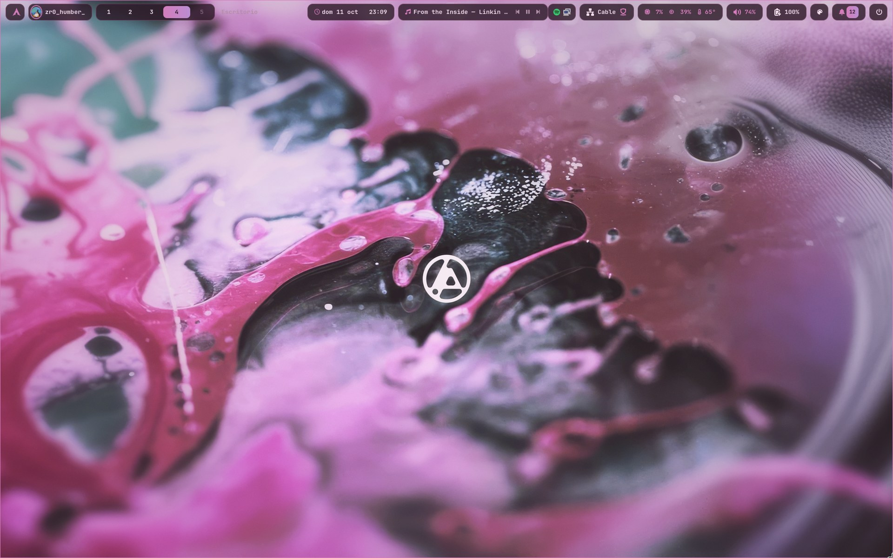
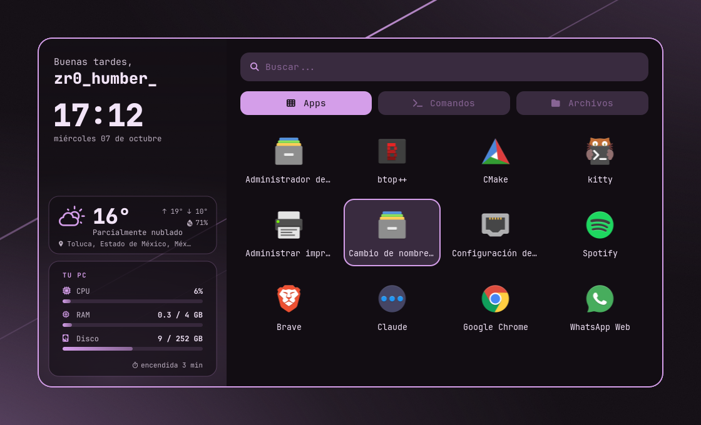
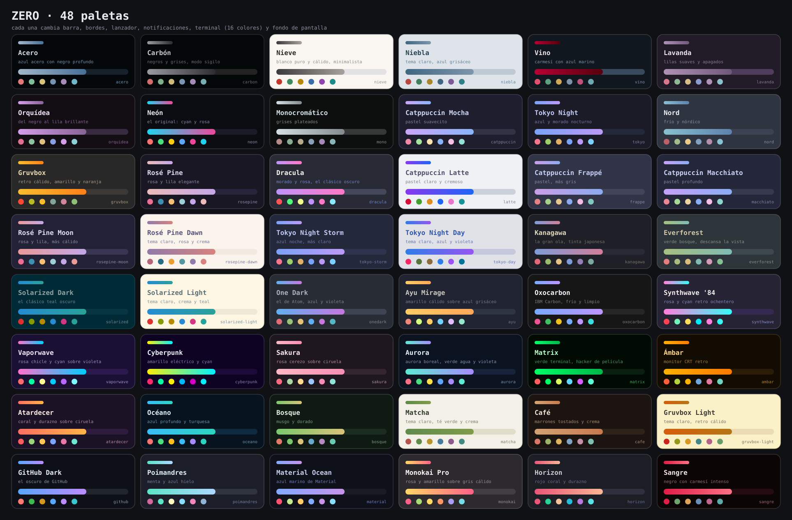
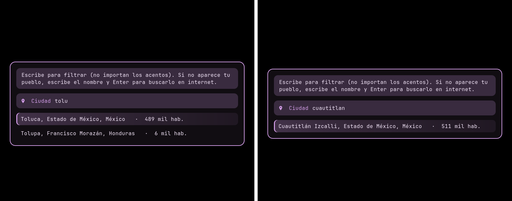

# ZERO — rice para Hyprland

[](https://github.com/Zer0-HMA/zero-rice/actions/workflows/revisar.yml)


[](LICENSE)

*[English version](README.en.md)*



Configuración completa para **Arch Linux + Hyprland** (config en Lua): barra con AGS, lanzador con clima y estadísticas, 48 paletas de colores que cambian todo el escritorio con un atajo, menú de red, capturas de pantalla con vista previa y más.



## Qué trae

- **Look de Hyprland:** bordes con degradado animado, esquinas redondeadas, blur, sombras y animaciones suaves.
- **Barra (AGS v3):** tu **foto de perfil** y nombre (se pone **blanca cuando eres root**), workspaces 1–5, reloj con calendario, música, red, CPU/RAM/temperatura, volumen, batería, bandeja, paletas, **contador de notificaciones** con No molestar y menú de energía. Tiene un guardián que la levanta sola si se cae.
- **6 estilos de barra** (`Super + Shift + B` o clic derecho en el botón de paletas): islas, flotante, bloque, neón, vidrio y minimal. Son independientes de la paleta, así que se combinan con las 48, y se cambian en vivo. Reloj, red y sistema se **expanden al pasar el mouse**, y la música trae un **espectro de audio** en tus colores.
- **Panel de control** (`Super + A` o el botón de ajustes de la barra): Wi-Fi, bluetooth, No molestar, micrófono, luz nocturna y Tailscale con un clic; volumen y brillo; música con portada; calendario y accesos a todos los menús del rice.
- **Neovim con LazyVim** que **sigue tu paleta**: al cambiar de paleta, todos los Neovim abiertos se repintan solos. Trae el logo de ZERO al iniciar, herramientas para editar el propio rice (bash, CSS, TS, Lua) y atajos `Espacio + z` para cambiar paleta y estilo de barra sin salir del editor.
- **OSD de volumen y brillo:** aparece en el monitor donde estás, con cualquier forma de cambiarlos (teclas, rueda, pavucontrol).
- **Workspaces en 3D:** 12 efectos (cubo, carrusel, puerta, túnel, persianas, mosaico…) al cambiar de workspace con `Super + número` o la rueda.
- **14 estilos de animaciones:** Elástico, Zoom, Cine, Retro, Fluido… con velocidad ajustable, desde un menú.
- **Lanzador (Rofi):** panel con saludo según la hora, reloj, **clima de tu ciudad** y estadísticas de tu PC; apps en cuadrícula y pestañas Apps / Comandos / Archivos.
- **48 paletas de colores:** cambian bordes, barra, lanzador, menús, notificaciones, terminal (con sus 16 colores) y fondo de pantalla al mismo tiempo. Puedes agregar las tuyas.
- **Paleta por cada imagen:** cada fondo tuyo guarda su propia paleta (pestaña "Imágenes" del menú); elegirla aplica sus colores y pone esa imagen.
- **5 estilos de fondo generado:** líneas, malla, aurora, rejilla synthwave y círculos, todos con los colores de tu paleta.
- **Motor de plantillas:** tematizar una app nueva es agregar un archivo `.tpl`, sin tocar código.
- **Bienvenida en la terminal:** logo, datos del sistema y tu paleta (o un saludo con clima) al abrir la terminal, con los colores de la paleta.
- **Clima:** detecta tu ciudad por internet, o la eliges de una lista que se filtra mientras escribes.
- **Menú de red:** Wi-Fi con barras de señal, redes ocultas, cable y configuración avanzada.
- **Capturas de pantalla:** área, pantalla o ventana; notificación con vista previa y botones Abrir / Carpeta / Editar / Borrar.
- **Pantalla de bloqueo (`zero-lock`):** 5 estilos (tarjetas, minimal, centrado, terminal, panel) y un menú para elegir fondo (con explorador de archivos y vista previa), desenfoque, brillo, tamaño, reloj 12/24 h, foto y qué elementos mostrar; sigue tu paleta.
- **Notificaciones (SwayNC)** y **fondos de pantalla** con selector de miniaturas: imágenes, **GIF animados** (awww) y **videos** (mpvpaper). Un video funciona como cualquier fondo: tiene su propia paleta, sale en el lanzador y en la pantalla de bloqueo, y se pausa solo cuando lo tapa una ventana a pantalla completa.
- **Bloqueo automático** a los 10 minutos (hypridle) con la misma pantalla de `zero-lock`.
- **Historial del portapapeles** (cliphist) con texto e imágenes.
- **Apps GTK con tu paleta:** Thunar y las demás apps GTK cambian de color y de modo claro/oscuro junto con todo lo demás.
- **Tailscale** en el menú de red y en la barra, si lo tienes instalado.
- Lo que un escritorio necesita para el día a día: agente de **polkit** (ventanas de contraseña) y **portal de escritorio** (compartir pantalla en Discord, Meet, OBS).

## Requisitos

- Arch Linux (o derivada con `pacman`).
- **Hyprland con config en Lua** (`hyprland.lua`, versión 0.55 o más nueva). Si todavía tienes `hyprland.conf`, actualiza primero con `sudo pacman -Syu hyprland`.
- Internet durante la instalación.

Todo lo demás lo instala el script: kitty, rofi, swaync, NetworkManager, pipewire, fuentes, íconos, AGS y sus librerías desde el AUR (instala `yay` si no lo tienes), etc.

## Instalación

```bash
git clone https://github.com/Zer0-HMA/zero-rice.git
cd zero-rice
./install.sh
```

El script pregunta antes de cada paso, respalda todo lo que reemplaza en `~/.config/rice-respaldo-<fecha>/` y al final te deja elegir la paleta inicial.

| Opción | Qué hace |
|---|---|
| `./install.sh --si` | Instala todo sin preguntar |
| `./install.sh --solo-configs` | No instala paquetes, solo las configuraciones |
| `./install.sh --paleta=tokyo` | Elige la paleta inicial |
| `./install.sh --actualizar` | Baja lo último del repo y actualiza (conserva tu paleta, tu fondo y tu ciudad) |
| `./install.sh --desinstalar` | Quita el rice (no borra paquetes; todo queda respaldado) |
| `./install.sh --version` | Muestra la versión |
| `./install.sh --enlazar` | Enlaza `~/.config` al repo en vez de copiar (para desarrollar el rice) |
| `./install.sh --sin-nvim` | No instala ni toca Neovim |

> Puedes correrlo desde la TTY antes de entrar a Hyprland por primera vez, o desde dentro de Hyprland (se aplica en vivo).

## Atajos

| Atajo | Acción |
|---|---|
| `Super + R` | Lanzador de apps |
| `Super + L` | Bloquear pantalla |
| `Super + Shift + L` | Personalizar la pantalla de bloqueo |
| `Super + Shift + P` | Cambiar paleta de colores |
| `Super + Ctrl + P` | Siguiente paleta |
| `Super + Alt + P` | Paleta aleatoria |
| `Super + Alt + I` | Paletas de tus imágenes |
| `Super + Shift + A` | Elegir estilo de animaciones |
| `Super + Shift + E` | Elegir efecto 3D de los workspaces |
| `Super + Shift + F` | Foto de perfil y nombre (o clic en tu nombre en la barra) |
| `Super + 1…0` / `Super + rueda` | Cambiar de workspace (con el efecto 3D que elegiste) |
| `Super + Shift + V` | Historial del portapapeles |
| `Super + Shift + C` | Elegir ciudad del clima |
| `Super + W` | Elegir fondo de pantalla (con miniaturas) |
| `Super + Shift + W` | Fondo aleatorio |
| `Super + Shift + I` | Usar una imagen de cualquier carpeta como fondo |
| `Super + N` | Centro de notificaciones |
| `Super + Shift + N` | Menú de red |
| `Super + A` | Panel de control |
| `Super + B` | Reiniciar la barra |
| `Super + Shift + B` | Estilo de la barra |
| `Impr Pant` / `Super + Shift + S` | Captura de un área |
| `Shift + Impr Pant` | Captura de pantalla completa |
| `Super + Impr Pant` | Captura de la ventana activa |
| `Super + Shift + Impr Pant` | Captura de pantalla en 5 segundos |

## Paletas



Se cambian con `Super + Shift + P`, con el botón de paleta de la barra o desde la terminal:

```bash
~/.config/hypr/scripts/paleta.sh tokyo         # una en específico
~/.config/hypr/scripts/paleta.sh siguiente     # la que sigue (también: anterior)
~/.config/hypr/scripts/paleta.sh aleatoria     # sorpresa
~/.config/hypr/scripts/paleta.sh lista         # ver todas en la terminal
```

Las paletas claras (Nieve, Niebla, Catppuccin Latte, Rosé Pine Dawn, Tokyo Night Day, Solarized Light, Matcha, Gruvbox Light) vuelven claro todo el escritorio; la terminal se mantiene oscura y el modo root de la barra se invierte para que siempre se note.

### Paletas de tus imágenes

El menú de paletas (`Super + Shift + P`) tiene **dos pestañas**:

- **Paletas:** las 48 de siempre (y las que tú agregues).
- **Imágenes:** una paleta **por cada fondo tuyo**, con su miniatura. Al elegir una se aplican sus colores y se pone esa imagen de fondo.

Cambias de pestaña con `Alt + 1` / `Alt + 2` o con la primera fila. `Super + Alt + I` abre directo en tus imágenes.

Las imágenes salen de `~/.config/wallpapers/` y de las que agregas con `Super + Shift + I`. Los colores se calculan una sola vez por imagen (y de nuevo solo si la cambias) y se guardan en `~/.config/rice-paletas/imagenes.txt`.

```bash
paleta.sh imagenes                 # ver la lista
paleta.sh imagen playa             # esa imagen de fondo + sus colores (por nombre)
paleta.sh desde-fondo              # solo los colores del fondo que tienes puesto
paleta.sh desde-fondo foto.jpg     # o de una imagen en específico
paleta.sh auto on                  # cada fondo nuevo (Super + W) cambia también los colores
```

`siguiente`, `anterior` y `aleatoria` solo recorren las paletas, no tus imágenes. Para que las paletas de tus imágenes sean de tema claro pon `MODO_IMAGENES=claro` en `~/.config/rice-paletas/ajustes.conf`. Necesita `imagemagick` (el instalador lo pone).

### Fondos generados

Cada paleta genera su propio fondo. Hay 5 estilos: `lineas` (el original), `malla`, `aurora`, `rejilla` (synthwave) y `circulos`.

```bash
paleta.sh fondo malla        # regenera el fondo de la paleta actual en ese estilo
paleta.sh fondo aleatorio    # uno al azar
```

Para dejar uno fijo, crea `~/.config/rice-paletas/ajustes.conf` (el instalador ya lo deja listo) con `ESTILO_FONDO=aurora`. Ahí mismo puedes poner `CAMBIAR_FONDO=0` si no quieres que la paleta toque tu fondo, `TEMA_KITTY=0` para que no cambie la terminal o `TEMA_GTK=0` para que no toque las apps GTK.

### Agregar tu propia paleta

Abre `~/.config/rice-paletas/paletas.txt`, copia una línea y cambia los colores. El formato viene explicado al principio del archivo. Además de fondo, texto y acentos, cada paleta puede traer **rojo, verde, amarillo, azul, magenta y cyan**: se usan en las alertas (batería baja, temperatura alta, confirmar apagado) y como colores de la terminal. Si los omites, se usan unos genéricos. Si el color de fondo es claro, todo el escritorio se vuelve tema claro automáticamente.

### Tematizar otra app (plantillas)

Los colores no están escritos dentro del script: viven en `~/.config/rice-plantillas/*.tpl`. Cada plantilla es el archivo de configuración de una app con `{{variables}}`, más una cabecera que dice dónde se escribe:

```
#@ destino: ~/.config/btop/themes/zero.theme
#@ requiere: cmd btop
theme[main_bg]="{{fondo}}"
theme[main_fg]="{{texto}}"
theme[hi_fg]="{{acento}}"
```

Al cambiar de paleta se rellenan todas las plantillas. Variables disponibles: `fondo fondo2 tenue texto acento acento2 sobre inactivo rojo verde amarillo azul magenta cyan` y `ansi0` … `ansi15`; formas: `{{acento.hex}}`, `{{acento.rgb}}`, `{{acento.a30}}` (30 % de opacidad), `{{acento.rgba30}}` (CSS) y `{{acento.hypr}}`. La lista completa está en `config/hypr/scripts/lib/plantillas.sh`.

## Terminal

Al abrir una terminal se muestra una bienvenida con los colores de tu paleta (cambia sola cuando cambias de paleta):

```bash
bienvenida info      # logo + datos del sistema + tu paleta + los colores de la terminal (fastfetch)
bienvenida saludo    # una línea: saludo, clima, tiempo encendida y RAM
bienvenida off       # nada al abrir
ff                   # fastfetch completo
```

Solo sale en la ventana nueva: no en subshells, ni en tmux, nvim o ventanas muy chicas. El instalador agrega una línea al **inicio** de `~/.zshrc`, antes del bloque de "instant prompt" de Powerlevel10k, que es donde debe ir:

```zsh
source "$HOME/.config/rice-terminal/bienvenida.zsh"
```

`fastfetch.jsonc` y `colores.zsh` (en `~/.config/rice-terminal/`) los genera `paleta.sh` desde las plantillas; en `colores.zsh` tienes los colores de tu paleta para tus propios scripts de zsh (`$RT_ACENTO`, `$RT_ROJO`...).

## Clima



- Al instalar, detecta tu ciudad por tu conexión a internet. Es aproximada, por eso dice "(aprox.)".
- Con `Super + Shift + C` eliges tu ciudad de una lista que **se filtra mientras escribes** (sin importar acentos). Las de tu país salen primero, con estado, país y población para no confundirte.
- Si tu pueblo no viene en la lista, escribe el nombre completo y presiona Enter para buscarlo en internet.
- La ciudad que elijas se queda guardada. Para volver a la detección automática: `~/.config/hypr/scripts/clima.sh auto`.
- Ver el clima en la terminal: `~/.config/hypr/scripts/clima.sh ver`.

## Pantalla de bloqueo (zero-lock)

`Super + L` bloquea; `Super + Shift + L` abre el menú para elegir estilo (`tarjetas`, `minimal`, `centrado`, `terminal`, `panel`), fondo, desenfoque, brillo, tamaño, reloj 12/24 h, colores, foto y qué elementos se ven. Sigue tu paleta y la usa también el bloqueo automático (hypridle) y el botón de la barra.

```bash
zero-lock                 # menú
zero-lock preview         # vista previa de 6 s
zero-lock estilo panel    # cambiar de estilo directo
zero-lock diagnostico     # ¿no bloquea? revisa hyprlock, hypridle, atajos y el log
```

Si la pantalla personalizada no se puede generar a tiempo o hyprlock falla con ella, se bloquea igual con una pantalla de emergencia: nunca te quedas sin bloqueo. El log queda en `~/.cache/zero-lock/zero-lock.log`.

## Perfil, animaciones y workspaces 3D

**Foto de perfil:** con `Super + Shift + F` eliges una foto de tu colección o agregas una de tus Imágenes o Descargas; se recorta en círculo sola y aparece en la barra, el lanzador y la pantalla de bloqueo (`~/.face`). Desde la terminal: `perfil.sh ~/foto.jpg`, `perfil.sh nombre "Humber"`, `perfil.sh quitar`.

**Animaciones:** `Super + Shift + A` abre el menú con los 14 estilos, la velocidad y el borde girando. Desde la terminal: `animaciones.sh elastico`, `animaciones.sh velocidad rapida`, `animaciones.sh probar`.

**Workspaces 3D:** `Super + Shift + E` para elegir el efecto (o `Aleatorio`, o `Sin efecto 3D`). Funciona tomando una captura de la pantalla y animándola en una capa de la barra, así que no necesita plugins. Desde la terminal: `ws3d.sh efecto cubo`, `ws3d.sh velocidad rapida`, `ws3d.sh probar`.

## Estilos de la barra

`Super + Shift + B` (o clic derecho en el botón de paletas de la barra) abre el menú. La forma es independiente de los colores: cualquier estilo funciona con cualquier paleta.

| Estilo | Cómo se ve |
|---|---|
| `islas` | cada módulo flota por su cuenta (el de siempre) |
| `flotante` | toda la barra es una sola cápsula flotando |
| `bloque` | barra sólida clásica, pegada arriba, con línea de acento |
| `neon` | islas con bordes que brillan en tu color de acento |
| `vidrio` | islas casi transparentes con el desenfoque de Hyprland |
| `minimal` | sin fondos: solo texto e iconos sobre tu fondo de pantalla |

```bash
barra-estilo.sh neon          # uno en específico
barra-estilo.sh siguiente     # el que sigue (también: anterior, aleatorio)
barra-estilo.sh lista         # ver todos
```

Cada estilo es un archivo en `~/.config/ags/estilos/`. Para crear el tuyo, copia uno con otro nombre, agrégalo a la lista `ESTILOS` de `barra-estilo.sh` y usa los colores de la paleta (`@fondo`, `@acento`, `@acento2`, `@sombra`…).

## Fondos animados y en video

Mete tus videos (mp4, webm, mkv, mov, m4v, avi) o GIF en `~/.config/wallpapers/`, o elígelos de cualquier carpeta con `Super + Shift + I`. En `Super + W` los videos llevan ▶ y su miniatura.

- **GIF:** los anima awww, sin nada extra.
- **Videos:** los reproduce **mpvpaper** (el instalador lo pone), en bucle y sin sonido. Debajo queda un cuadro del video como imagen, así que el cambio de fondo se ve con la transición de siempre y nunca hay un parpadeo negro.
- **Todo sigue funcionando:** cada video tiene su paleta (`Super + Alt + I`), y el panel del lanzador y la pantalla de bloqueo usan un cuadro suyo.
- **No se duplican en tu disco:** los videos que eliges de otra carpeta se **enlazan** en vez de copiarse (pesan mucho). Si borras o mueves el original, sale de tu lista.

```bash
wall.sh ~/Videos/lluvia.mp4    # ponerlo de fondo (y agregarlo a tu lista)
wall.sh video alternar         # pausar / reanudar  (también: pausa, seguir)
wall.sh video parar            # quitar el video y dejar su cuadro como imagen (vuelve al reiniciar sesión)
```

Para ahorrar batería, el video se pausa solo mientras hay una ventana a pantalla completa. Se ajusta en `~/.config/rice-paletas/ajustes.conf`:

```bash
VIDEO_PAUSA=FULL   # FULL: pantalla completa · MAX: también maximizadas · ACTIVE: con cualquier ventana enfocada · no: nunca
VIDEO_SONIDO=0     # 1 = que suene
```

`ACTIVE` es la que más ahorra: el video solo se mueve cuando estás viendo el escritorio. (`MAX` y `ACTIVE` necesitan un mpvpaper reciente; con uno viejo se usa la pausa básica.)

## Panel de control

`Super + A` (o el botón de ajustes de la barra) despliega el panel en el monitor donde estás. Se cierra con `Esc` o con un clic fuera.

- **Botones rápidos:** Wi-Fi, bluetooth, No molestar, micrófono, luz nocturna (hyprsunset, 4500 K) y Tailscale. Los que no aplican a tu equipo no aparecen (por ejemplo, bluetooth sin adaptador).
- **Volumen y brillo** (el brillo solo en laptops), **música** con portada, controles y barra de avance, y la **fecha**, que despliega el calendario.
- **Accesos** a los menús de paleta, estilo de barra, fondo, animaciones, captura y portapapeles.

Desde la terminal o tus propios atajos: `ags request panel` (alterna), `ags request panel abrir` o `ags request panel cerrar`.

## Neovim

El instalador pone **LazyVim** en `~/.config/nvim` (si ya tenías una config, la respalda antes de preguntar). Los colores salen de tu paleta: `paleta.sh` escribe `~/.config/rice-nvim/paleta.lua` y Neovim la convierte en un tema base16 y se repinta solo cuando cambia.

| Atajo | Acción |
|---|---|
| `Espacio + z + p` | Elegir paleta |
| `Espacio + z + n` / `a` | Siguiente paleta / aleatoria |
| `Espacio + z + b` | Estilo de la barra |
| `Espacio + z + r` | Recargar colores (también `:ZeroColores`) |

Tus cambios van en `~/.config/nvim/lua/plugins/mio.lua` (el instalador nunca lo toca). Si prefieres el fondo opaco en vez del de kitty, pon `vim.g.zero_transparente = false` en `lua/config/options.lua`.

## Personalizar

- **Tus propios ajustes de Hyprland** (monitores, teclado, más atajos…) van en `~/.config/hypr/mio.lua`. Se carga al final del rice, así que le gana a todo, y **el instalador nunca lo toca**, ni al actualizar. Ejemplo:

  ```lua
  hl.config({ input = { kb_layout = "latam" } })
  hl.bind("SUPER + T", hl.dsp.exec_cmd("thunar"))
  ```

- **Tus fondos de pantalla** van en `~/.config/wallpapers/` (jpg, png, webp, gif). Elígelos con `Super + W`. Para usar una imagen que está en otra carpeta (Descargas, Imágenes...), `Super + Shift + I` abre un navegador con miniaturas; la imagen se copia a tus fondos. También: `wall.sh /ruta/a/foto.jpg`.
- **Carpeta de capturas:** `~/Pictures/Capturas` (o la carpeta de imágenes de tu idioma). Se copian solas al portapapeles.

## Para desarrollar el rice (modo enlazado)

```bash
./install.sh --enlazar
```

En vez de copiar los archivos a `~/.config`, los **enlaza al repo**: lo que edites en `~/.config/hypr/rice.lua` o en la barra queda directo en git, listo para `git commit`. Lo que generan las paletas y las animaciones (`colores.css`, `colores.lua`, `animaciones.lua`…) se queda en `~/.config` y nunca ensucia el repo. Se recuerda entre actualizaciones; para volver a copias normales: `./install.sh --copiar`.

## Dónde se guarda cada cosa

| Qué | Dónde |
|---|---|
| Configuración (lo que puedes editar) | `~/.config/hypr`, `~/.config/ags`, `~/.config/rofi`, `~/.config/rice-paletas`, `~/.config/zero-lock` |
| Tus ajustes personales | `~/.config/hypr/mio.lua` (el instalador nunca lo toca) |
| Paleta actual | `~/.config/rice-paletas/actual` |
| Tu ciudad del clima | `~/.local/state/zero-rice/clima` |
| Tus fotos de perfil | `~/.config/rice-perfil` (no se borran al desinstalar) |
| Efecto 3D y animaciones elegidas | `~/.config/rice-ws3d` y `~/.config/rice-animaciones` |
| Estilo de la barra elegido | `~/.config/rice-barra/estilo` |
| Neovim | `~/.config/nvim` (colores en `~/.config/rice-nvim`) |
| Caché: clima, ciudades, panel del lanzador, bloqueo | `~/.cache/zero-rice` y `~/.cache/zero-lock` (se pueden borrar sin problema) |
| Logs | `$XDG_RUNTIME_DIR/zero-rice` y `~/.cache/zero-lock/zero-lock.log` |

## Privacidad

Para el clima, el rice consulta tu ubicación aproximada por IP a [ip-api.com](https://ip-api.com) (por HTTP, sin cifrar) o, si falla, a [ipinfo.io](https://ipinfo.io). Si prefieres que no se consulte nada, elige tu ciudad con `Super + Shift + C`: así ya no se vuelve a detectar. El clima en sí viene de [Open-Meteo](https://open-meteo.com), que solo recibe las coordenadas de la ciudad.

## Problemas comunes

**`Super + L` no bloquea (o te vuelve a bloquear justo después de escribir tu contraseña).** Es un bug de hyprlock 0.9.6 con Hyprland 0.56: a veces se congela o se cae al desbloquear ([hyprlock#1055](https://github.com/hyprwm/hyprlock/issues/1055)). Desde la 0.5.1, `zero-lock` le pregunta a Hyprland si la sesión está bloqueada de verdad (`hyprctl locked`): si encuentra un hyprlock colgado lo cierra y bloquea de nuevo, y si hyprlock se cae al desbloquear ya no te vuelve a bloquear. Actualiza con `./install.sh --actualizar`. El arreglo de fondo llegará con la próxima versión de hyprlock; si no quieres esperar: `yay -S hyprlock-git`.

**Sigue sin bloquear.** Corre `zero-lock diagnostico`: te dice qué lanzó cada hyprlock que esté abierto, a qué está atado `Super + L`, si zero-lock ha bloqueado alguna vez en tu compu, con qué bloquea hypridle y, si bloquear tarda, qué paso es el lento. Si vienes de una versión anterior a la 0.3.0, actualiza con `./install.sh --actualizar` (antes, con el bluetooth apagado, el bloqueo se quedaba trabado).

**`./install.sh` dice "Permiso denegado".** Córrelo con `bash install.sh`, o actualiza el repo (`git pull`): la 0.3.0 ya trae el permiso.

**La barra no aparece.** Corre `~/.config/hypr/scripts/barra.sh log` para ver el error. Si dice que falta algo de `Astal`, instala `yay -S libastal-meta`.

**La barra se cae al iniciar sesión, o salen dos.** Revisa que tu `hyprland.lua` no arranque `ags`, `swaync` o el daemon de fondos por su cuenta: el rice ya los arranca. El instalador lo detecta y te ofrece desactivarlos.

**El cursor parpadea o se ve feo en el segundo monitor (NVIDIA).** Pon esto en tu `mio.lua`:

```lua
hl.env("XCURSOR_THEME", "Bibata-Modern-Classic")
hl.env("HYPRCURSOR_THEME", "Bibata-Modern-Classic")
hl.config({ cursor = { no_hardware_cursors = 1 } })
```

y instala el tema con `yay -S bibata-cursor-theme-bin`.

**Sale una barra roja arriba de la pantalla.** Es un error en la config de Hyprland. Si acabas de editar `mio.lua`, revisa ese archivo.

**El clima dice "no disponible".** Revisa tu internet y elige tu ciudad con `Super + Shift + C`.

**El fondo de pantalla no cambia.** El proyecto `swww` se renombró a `awww`; el instalador instala `awww` desde el AUR, y los scripts usan el que tengas.

**Tailscale dice que necesita permiso.** Para conectarlo y desconectarlo desde el menú sin `sudo`, corre una vez `sudo tailscale set --operator=$USER`.

**Una app no me pide la contraseña de administrador.** Revisa que el agente de polkit esté corriendo: `systemctl --user status hyprpolkitagent`.

## Estructura del repo

```
zero-rice/
├── install.sh                      instalador (instalar / actualizar / desinstalar)
├── VERSION · CHANGELOG.md · LICENSE
├── config/
│   ├── hypr/rice.lua               look, autoinicio y atajos
│   ├── hypr/hypridle.conf          bloqueo automático
│   ├── hypr/scripts/               barra, paleta, clima, panel, lanzador, red, captura, wall, elegir-fondo,
│   │                               temp, portapapeles, perfil, animaciones, ws3d, zero-lock, barra-estilo
│   ├── hypr/scripts/lib/           motor de paletas: color, plantillas, fondos, desde imagen
│   ├── ags/                        barra (app.tsx + style.css), workspaces 3D (ws3d.tsx + efectos3d.ts)
│   ├── ags/panel.tsx               panel de control (Super + A)
│   ├── ags/estilos/                los 6 estilos de la barra
│   ├── nvim/                       Neovim con LazyVim (lua/zero = puente con la paleta)
│   ├── rofi/                       lanzador
│   ├── swaync/                     notificaciones
│   ├── terminal/                   bienvenida de la terminal
│   ├── rice-plantillas/            una plantilla .tpl por app (barra, rofi, swaync, kitty, hyprland, gtk, hyprlock…)
│   └── rice-paletas/paletas.txt    las 48 paletas
└── capturas/                       imágenes de este README
```

Los colores de la barra, Rofi, SwayNC, kitty, GTK, hyprlock y Hyprland no están escritos en el repo: `paleta.sh` los genera a partir de las plantillas y de la paleta que elijas.

## Contribuir

¿Encontraste un error? [Abre un issue](https://github.com/Zer0-HMA/zero-rice/issues/new/choose) con el log de la barra (`barra.sh log`), el de `zero-lock diagnostico` si es del bloqueo, y tu versión de Hyprland. Cada cambio pasa por una revisión automática (ShellCheck, sintaxis de Lua y TypeScript, y que la pantalla de bloqueo se genere sin colgarse) en GitHub Actions.

## Créditos

- [Hyprland](https://hypr.land), [AGS / Astal](https://github.com/Aylur/ags), [Rofi](https://github.com/davatorium/rofi), [SwayNotificationCenter](https://github.com/ErikReider/SwayNotificationCenter), [awww](https://github.com/LGFae/swww)
- Clima: [Open-Meteo](https://open-meteo.com) (gratis, sin cuenta)
- Lista de ciudades: [GeoNames](https://www.geonames.org) (licencia CC BY 4.0)
- Ubicación aproximada: [ip-api.com](https://ip-api.com) e [ipinfo.io](https://ipinfo.io)
- Íconos: [Nerd Fonts](https://www.nerdfonts.com) y [Papirus](https://github.com/PapirusDevelopmentTeam/papirus-icon-theme)
- Pantalla de bloqueo e inactividad: [hyprlock](https://github.com/hyprwm/hyprlock) y [hypridle](https://github.com/hyprwm/hypridle); portapapeles: [cliphist](https://github.com/sentriz/cliphist)
- Paletas inspiradas en Catppuccin, Tokyo Night, Nord, Gruvbox, Rosé Pine, Dracula, Kanagawa, Everforest, Solarized, One Dark, Ayu, Oxocarbon, Synthwave '84, GitHub, Poimandres, Material, Monokai Pro y Horizon, de sus respectivos proyectos

## Licencia

[MIT](LICENSE) © Zer0-HMA
